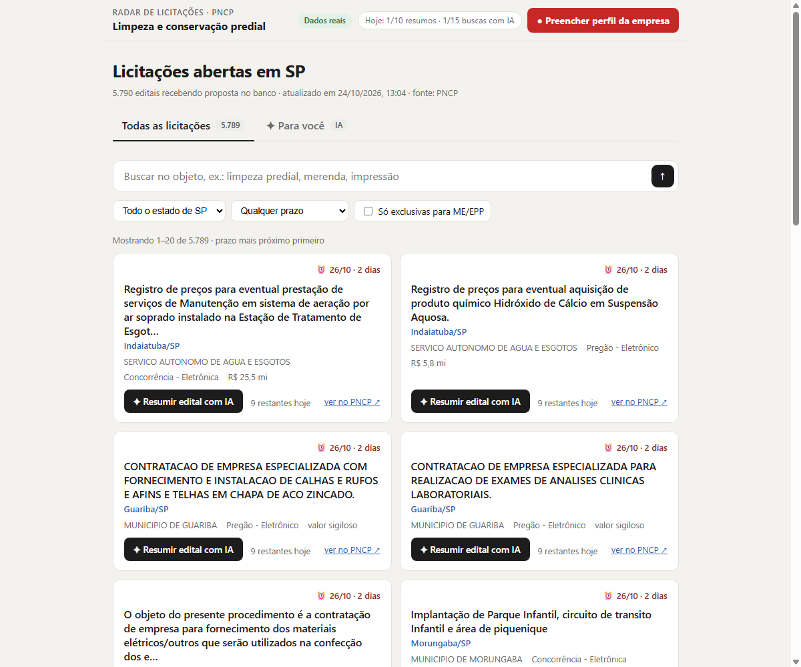
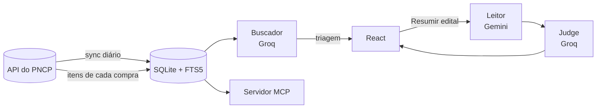
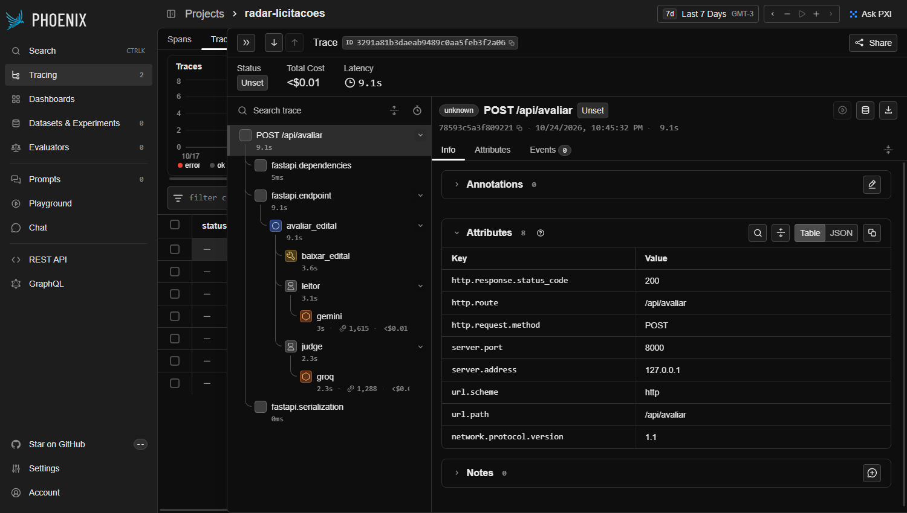

# Radar de Licitações

Encontra licitações abertas no [PNCP](https://pncp.gov.br) para uma pequena empresa, lê o edital e diz, em português simples, se vale a pena participar.

[](https://github.com/DaviFLimaAndrade/ToDentro_licitacoes/actions/workflows/ci.yml)



Pequenas empresas quase não disputam licitações: os editais são longos, burocráticos e espalhados. O Radar junta as licitações abertas de São Paulo num lugar só e usa IA em três etapas: separar as que servem para o perfil da empresa, ler o edital e julgar se vale a pena.

## Números

| | |
| --- | --- |
| Licitações abertas de SP no banco | 5.789 (atualizado todo dia) |
| Exclusivas para micro e pequenas empresas | **1.260 (22%)** |
| Resumo de um edital com texto | **~8 s** (era ~27 s antes das otimizações) |
| Resumo de um edital escaneado de 28 MB | ~72 s (era ~145 s) |
| Triagem da IA: precisão / recall | **87% / 95%** em 61 licitações reais ([relatório](data/avaliacao/relatorio_triagem.md)) |
| Custo | R$ 0 (Groq e Gemini no free tier, VM Always Free) |

## Como funciona



- **Buscador (Groq):** transforma o perfil ou a pergunta em termos de busca com sinônimos, pega as 50 mais relevantes no banco (FTS5) e faz a triagem: é serviço do segmento da empresa ou só cita a palavra? ("limpeza de poços" e "aquisição de material de limpeza" ficam de fora.)
- **Leitor (Gemini):** extrai do edital prazo, valor, modalidade, vigência e exigências. Edital com texto vai como texto; escaneado vai como PDF, que o Gemini lê como imagem.
- **Judge (Groq):** cruza a ficha do edital com o perfil e diz alta, média ou baixa aderência, o motivo e o que confirmar antes de participar.
- **Servidor MCP:** as mesmas ferramentas (`buscar_licitacoes`, `detalhar_licitacao`, `baixar_edital`) funcionam em qualquer cliente MCP, como o Claude Desktop.

Cada pergunta vira um trace no [Phoenix](https://github.com/Arize-ai/phoenix), com o tempo e os tokens de cada agente:



## Decisões técnicas

- **Banco local em vez de consultar o PNCP a cada pergunta.** A API leva ~5 s por página, devolve no máximo 50 por página (o Swagger diz 500) e responde 429. Um sync diário grava tudo no SQLite; a busca responde em ~20 ms.
- **Sem Docling.** Ele pesa ~2 GB, é lento na CPU e não cabe na VM de 1 GB. O texto sai com `pypdfium2` (0,3 s por edital) e o escaneado vai direto para o Gemini, que é multimodal.
- **Thinking do Gemini desligado.** Extrair campos não precisa de raciocínio; a geração caiu de 16 s para 5 s sem perder qualidade nas fichas comparadas.
- **Triagem medida, não presumida.** Os rótulos vêm dos itens de cada compra no PNCP (material ou serviço, descrição do catálogo), que a IA não vê; os casos ambíguos foram revisados com o motivo registrado ([revisão](data/avaliacao/revisao_manual.json)). Uma tentativa de ajustar o prompt derrubou o recall para 43% e foi revertida.
- **Selo ME/EPP pelo benefício declarado item a item.** O campo "material ou serviço" do PNCP não foi usado na tela: vários órgãos cadastram serviço de limpeza como "Material".
- **Limite por pessoa.** 10 resumos e 15 buscas com IA por IP por dia, visíveis na tela, para o free tier aguentar um site público. Resumo que já está no cache não conta.

## Limitações conhecidas

- A triagem julga em lotes de 25, e a mesma licitação pode ser aceita num lote e descartada em outro. Próximo passo: regras por palavra-chave antes da IA e lotes estáveis.
- A avaliação cobre um segmento (limpeza predial) e 61 licitações; 18 rótulos vieram de revisão por IA, não humana.
- Só o estado de São Paulo, com foco em Campinas e região.
- Edital escaneado ainda leva cerca de 1 minuto.

## Rodando localmente

Precisa de Python 3.11+, Node 24 e chaves grátis do [Groq](https://console.groq.com) e do [Gemini](https://aistudio.google.com).

```bash
python -m venv .venv && source .venv/bin/activate     # Windows: .venv\Scripts\activate
pip install -e ".[dev,agents,api]"
cp .env.example .env                                  # preencha as chaves
python -m radar.sync                                  # ~10 min: licitações abertas de SP
python -m radar.enriquecer --limite 6000              # ~1h30: itens e ME/EPP (pode parar e retomar)
cd frontend && npm ci && npm run build && cd ..
uvicorn radar.api:app --port 8000                     # http://localhost:8000
```

Outros comandos:

```bash
pytest                                       # testes (sem rede)
python -m radar.avaliacao                    # mede a triagem
python -m radar.mcp_server                   # servidor MCP (stdio)
pip install -e ".[tracing]" && python -m phoenix.server.main serve   # Phoenix em http://localhost:6006
```

### No Claude Desktop

Em `claude_desktop_config.json`:

```json
{
  "mcpServers": {
    "radar-licitacoes": {
      "command": "/caminho/para/radar-licitacoes/.venv/bin/python",
      "args": ["-m", "radar.mcp_server"]
    }
  }
}
```

## Deploy

VM Always Free da Oracle com Docker e Caddy: veja [deploy/README.md](deploy/README.md).

## Stack

Python 3.11 · FastAPI · SQLite (FTS5) · MCP · Groq (`gpt-oss-120b`) · Gemini 2.5 Flash · pypdfium2 · React 19 + Vite + TypeScript · Phoenix (OpenTelemetry) · Docker + Caddy

---

Projeto independente, sem vínculo com o governo. Dados públicos do [Portal Nacional de Contratações Públicas](https://pncp.gov.br).
